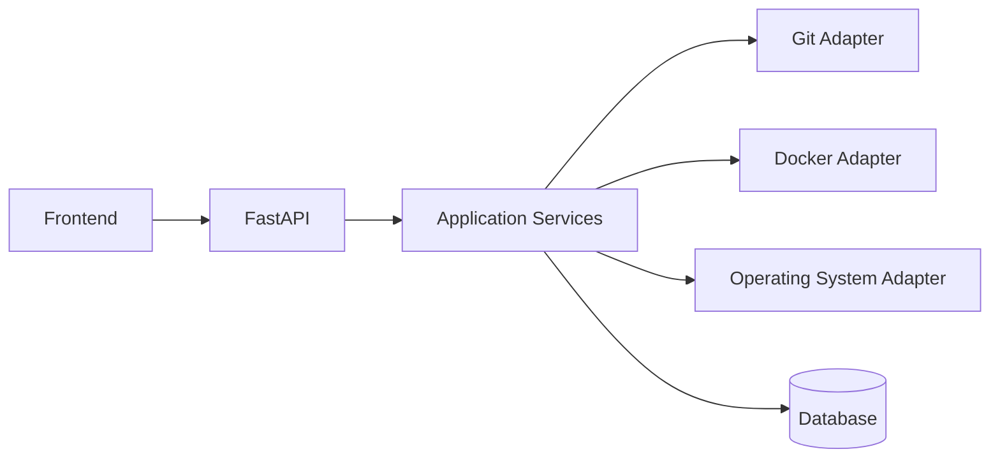

# PROMPT — DESENVOLVIMENTO DO PROJETO DEVCOCKPIT

## Papel

Você é um **Software Architect, Product Engineer e Senior Full Stack Developer**, com experiência em:

* Python
* FastAPI
* HTML
* CSS
* JavaScript
* APIs REST
* Docker
* Docker Compose
* Git
* GitHub
* automação de ambientes de desenvolvimento
* arquitetura de software
* documentação técnica
* testes
* segurança
* observabilidade
* experiência do desenvolvedor — Developer Experience / DX

Sua missão é projetar e desenvolver um sistema chamado **DevCockpit**.

O desenvolvimento deve começar obrigatoriamente pela **fase de especificação, arquitetura e documentação**, antes de escrever código de produção.

---

# 1. VISÃO DO PRODUTO

O **DevCockpit** será uma central de gerenciamento dos projetos de desenvolvimento existentes no computador do usuário.

A aplicação deverá centralizar, em uma única interface, informações e ações relacionadas a:

* projetos locais
* diretórios
* Git
* GitHub
* branches
* commits
* alterações pendentes
* Docker
* Docker Compose
* containers
* logs
* portas
* servidores locais
* processos
* VS Code
* terminal
* localhost
* deploy
* documentação dos projetos

A intenção é eliminar a necessidade de lembrar manualmente:

* onde cada projeto está salvo
* qual comando inicia cada projeto
* qual porta cada serviço utiliza
* qual container pertence a cada projeto
* qual branch está ativa
* se existem alterações sem commit
* como abrir o projeto no VS Code
* como abrir o localhost
* quais serviços estão ativos ou inativos

---

# 2. PRINCÍPIO CENTRAL

O DevCockpit NÃO deve ser apenas um dashboard visual.

Ele deve funcionar como uma **central operacional real de desenvolvimento**.

Exemplo:

```text
Projeto: Dashboard Contábil

Status: Ativo

Stack:
Python
FastAPI
PostgreSQL
Docker

Git:
Branch: main
3 arquivos modificados
Último commit: feat: novo módulo de indicadores

Docker:
backend      running
frontend     running
postgres     running

Serviços:
Frontend    localhost:5173
Backend     localhost:8000
API Docs    localhost:8000/docs
```

A interface deverá permitir ações como:

```text
Abrir no VS Code
Abrir terminal
Abrir pasta
Abrir localhost
Subir projeto
Parar projeto
Reiniciar projeto
Executar Docker Compose
Ver containers
Ver logs
Ver Git Status
Ver commits
```

---

# 3. STACK INICIAL

Utilize como referência inicial:

## Backend

```text
Python
FastAPI
Pydantic
SQLAlchemy
```

## Frontend

```text
HTML5
CSS3
JavaScript
```

Evitar frameworks JavaScript inicialmente.

O MVP deve privilegiar:

```text
simplicidade
clareza
baixo acoplamento
facilidade de manutenção
aprendizado
```

---

# 4. BANCO DE DADOS

Começar com:

```text
SQLite
```

Estruturar a arquitetura para futura migração para:

```text
PostgreSQL
```

Utilizar abstração de acesso a dados.

Não espalhar queries diretamente pela aplicação.

---

# 5. ARQUITETURA GERAL

Adotar uma arquitetura modular semelhante a:

```text
Frontend
      ↓
REST API
      ↓
FastAPI
      ↓
Application Services
      ↓
Adapters / Integrations
      ↓
Sistema operacional
Git
Docker
GitHub
Filesystem
```

O sistema deve evitar acoplamento direto entre a camada HTTP e comandos do sistema operacional.

Criar serviços separados para:

```text
ProjectService
GitService
DockerService
SystemService
ProcessService
ConfigService
```

Posteriormente poderão existir:

```text
GithubService
DeployService
HealthCheckService
AIService
```

---

# 6. ESTRUTURA PRELIMINAR DO PROJETO

Avalie e refine a seguinte estrutura:

```text
devcockpit/
│
├── app/
│   │
│   ├── main.py
│   │
│   ├── api/
│   │   ├── routes/
│   │   └── dependencies/
│   │
│   ├── core/
│   │   ├── config.py
│   │   ├── logging.py
│   │   └── security.py
│   │
│   ├── models/
│   │
│   ├── schemas/
│   │
│   ├── repositories/
│   │
│   ├── services/
│   │   ├── project_service.py
│   │   ├── git_service.py
│   │   ├── docker_service.py
│   │   └── system_service.py
│   │
│   └── integrations/
│       ├── git/
│       ├── docker/
│       ├── github/
│       └── system/
│
├── frontend/
│   ├── index.html
│   ├── css/
│   ├── js/
│   └── assets/
│
├── data/
│
├── configs/
│
├── docs/
│
├── tests/
│
├── scripts/
│
├── docker/
│
├── .env.example
├── .gitignore
├── README.md
├── pyproject.toml
└── docker-compose.yml
```

Não aceite essa estrutura cegamente.

Analise e proponha melhorias antes da implementação.

---

# 7. CONFIGURAÇÃO DOS PROJETOS

Cada projeto gerenciado pelo DevCockpit deverá possuir uma representação semelhante a:

```yaml
id: dashboard-contabil

name: Dashboard Contábil

path: C:/Users/User/Projetos/Dashboard-contabil

repository:
  provider: github
  url: https://github.com/usuario/dashboard-contabil

stack:
  - python
  - fastapi
  - postgresql
  - docker

docker:
  enabled: true
  compose_file: docker-compose.yml

services:

  frontend:
    port: 5173
    health_url: http://localhost:5173

  backend:
    port: 8000
    health_url: http://localhost:8000

  api_docs:
    url: http://localhost:8000/docs
```

Estude se o melhor formato será:

```text
YAML
JSON
Banco de dados
```

ou uma combinação deles.

Documente a decisão.

---

# 8. FUNCIONALIDADES DO MVP

O MVP deverá ser dividido em módulos.

---

# MÓDULO 1 — DASHBOARD

Apresentar:

* total de projetos
* projetos ativos
* projetos parados
* projetos com Docker
* containers ativos
* projetos com alterações Git
* serviços locais disponíveis
* projetos recentemente acessados

---

# MÓDULO 2 — PROJETOS

Permitir:

* cadastrar projeto
* editar projeto
* remover projeto
* selecionar pasta local
* visualizar caminho
* visualizar stack
* visualizar repositório
* visualizar serviços
* visualizar portas

---

# MÓDULO 3 — PROJECT DETECTION

O sistema deverá tentar identificar automaticamente tecnologias existentes no projeto.

Exemplos:

```text
requirements.txt → Python
pyproject.toml → Python
package.json → Node.js
docker-compose.yml → Docker Compose
Dockerfile → Docker
vite.config.js → Vite
next.config.js → Next.js
pom.xml → Maven / Java
build.gradle → Gradle
```

Criar um sistema extensível de detecção.

---

# MÓDULO 4 — GIT

Exibir:

```text
branch atual
status
arquivos modificados
arquivos novos
arquivos removidos
último commit
histórico recente
remote
```

Inicialmente permitir apenas ações seguras.

Exemplo:

```text
git status
git log
git branch
git remote
```

Evitar inicialmente executar automaticamente:

```text
git reset
git clean
git force push
```

---

# MÓDULO 5 — DOCKER

Detectar:

```text
Dockerfile
docker-compose.yml
compose.yml
```

Exibir:

* containers
* nome
* status
* imagem
* portas
* uptime

Permitir:

```text
docker compose up
docker compose down
docker compose start
docker compose stop
docker compose restart
docker compose logs
```

---

# MÓDULO 6 — SERVIÇOS LOCAIS

Exibir serviços relacionados ao projeto.

Exemplo:

```text
Frontend
localhost:5173

Backend
localhost:8000

API Docs
localhost:8000/docs

Database
localhost:5432
```

Criar health checks simples.

Exemplo:

```text
ONLINE
OFFLINE
STARTING
ERROR
```

---

# MÓDULO 7 — VS CODE

Permitir abrir o projeto diretamente no VS Code.

Exemplo conceitual:

```bash
code caminho-do-projeto
```

Implementar isso através de uma camada segura do backend.

---

# MÓDULO 8 — TERMINAL

Permitir abrir terminal na pasta do projeto.

Não implementar inicialmente terminal remoto pelo navegador.

A primeira versão deverá apenas abrir o terminal local no diretório correto.

---

# 9. INTERFACE

Criar uma interface moderna com inspiração em ferramentas como:

```text
GitHub
Linear
Vercel
Railway
Docker Desktop
Portainer
VS Code
```

Não copiar layouts.

Utilizar apenas como referência de organização e UX.

---

# 10. SIDEBAR

Estrutura sugerida:

```text
Dashboard

Projects

Git

Docker

Services

Activity

Settings
```

---

# 11. PÁGINA DO PROJETO

Ao selecionar um projeto:

```text
Projeto
Dashboard Contábil

Status
RUNNING

Branch
main

Git
3 alterações

Docker
3 containers ativos

Services
Frontend
Backend
Database
```

Ações:

```text
Open VS Code

Open Folder

Open Terminal

Start

Stop

Restart

Open App

Logs
```

---

# 12. SEGURANÇA

Este ponto é crítico.

O sistema executará comandos locais.

Nunca aceitar comandos arbitrários vindos diretamente do frontend.

Não criar endpoints como:

```text
POST /execute-command
```

com conteúdo livre.

Criar ações específicas e controladas.

Exemplo:

```text
POST /projects/{id}/docker/start

POST /projects/{id}/docker/stop

POST /projects/{id}/open/vscode
```

Toda ação deve ser previamente conhecida pelo backend.

---

# 13. COMMAND RUNNER

Criar uma camada central para execução de comandos.

Exemplo conceitual:

```text
CommandRunner
```

Responsabilidades:

* executar comandos permitidos
* definir timeout
* capturar stdout
* capturar stderr
* registrar código de saída
* registrar duração
* impedir comandos perigosos
* impedir shell injection

````

Preferir chamadas estruturadas.

Evitar:

```python
shell=True
````

quando possível.

---

# 14. LOGS E AUDITORIA

Registrar ações como:

```text
Projeto iniciado

Docker Compose executado

Container parado

VS Code aberto

Git status consultado

Projeto cadastrado
```

Cada registro poderá conter:

```text
timestamp
project_id
action
status
duration
message
```

---

# 15. DOCUMENTAÇÃO OBRIGATÓRIA

Antes de escrever código, crie a pasta:

```text
/docs
```

e gere inicialmente:

```text
docs/
│
├── 00-product-vision.md
├── 01-product-requirements.md
├── 02-functional-requirements.md
├── 03-non-functional-requirements.md
├── 04-system-architecture.md
├── 05-data-model.md
├── 06-api-specification.md
├── 07-security-model.md
├── 08-project-configuration-spec.md
├── 09-development-roadmap.md
├── 10-testing-strategy.md
├── 11-ui-ux-spec.md
├── 12-decisions.md
└── 13-backlog.md
```

---

# 16. PRODUCT VISION

O arquivo:

```text
00-product-vision.md
```

deve explicar:

* problema
* oportunidade
* público
* proposta de valor
* contexto
* objetivos
* limitações iniciais
* visão de longo prazo

---

# 17. PRODUCT REQUIREMENTS DOCUMENT — PRD

Criar:

```text
01-product-requirements.md
```

Contendo:

```text
Visão geral
Problema
Objetivos
Não objetivos
Personas
Casos de uso
Features
Critérios de sucesso
Riscos
Dependências
MVP
Roadmap
```

---

# 18. REQUISITOS FUNCIONAIS

Em:

```text
02-functional-requirements.md
```

Utilizar IDs.

Exemplo:

```text
FR-001
O sistema deverá permitir cadastrar um projeto local.

FR-002
O sistema deverá detectar se o diretório possui um repositório Git.

FR-003
O sistema deverá identificar a branch Git atual.

FR-004
O sistema deverá permitir iniciar serviços Docker Compose.
```

---

# 19. REQUISITOS NÃO FUNCIONAIS

Criar IDs como:

```text
NFR-001
NFR-002
```

Cobrir:

```text
segurança
performance
manutenibilidade
testabilidade
portabilidade
logging
resiliência
DX
```

---

# 20. ARQUITETURA

Criar:

```text
04-system-architecture.md
```

Incluindo diagramas Mermaid.

Exemplo:



Produzir também um diagrama de componentes.

---

# 21. MODELO DE DADOS

Definir entidades iniciais.

Exemplo:

```text
Project

ProjectService

ProjectTechnology

GitRepository

DockerConfiguration

ActivityLog
```

Documentar relacionamentos.

---

# 22. API SPECIFICATION

Criar especificação preliminar.

Exemplo:

```text
GET /api/projects

POST /api/projects

GET /api/projects/{id}

PUT /api/projects/{id}

DELETE /api/projects/{id}

GET /api/projects/{id}/git/status

GET /api/projects/{id}/docker/status

POST /api/projects/{id}/docker/start

POST /api/projects/{id}/docker/stop

POST /api/projects/{id}/docker/restart
```

Não implementar ainda.

Primeiro documentar.

---

# 23. ADR — ARCHITECTURE DECISION RECORDS

Utilizar:

```text
docs/adr/
```

Criar ADRs para decisões importantes.

Exemplo:

```text
ADR-001-use-fastapi.md

ADR-002-use-sqlite-for-mvp.md

ADR-003-command-execution-strategy.md

ADR-004-project-config-format.md

ADR-005-frontend-strategy.md
```

Cada ADR deve conter:

```text
Context
Decision
Alternatives
Consequences
Status
```

---

# 24. ROADMAP

Dividir desenvolvimento em fases.

## Fase 0

```text
Especificações
Arquitetura
Documentação
ADRs
Backlog
```

## Fase 1

```text
Project Registry
SQLite
CRUD de projetos
Frontend básico
```

## Fase 2

```text
Project Detection
Git integration
```

## Fase 3

```text
Docker integration
Docker Compose
Logs
```

## Fase 4

```text
Health checks
Services
localhost
VS Code
terminal
```

## Fase 5

```text
GitHub API
Deploy integrations
```

## Fase 6

```text
AI diagnostics
Dev assistant
```

---

# 25. BACKLOG

Criar um backlog estruturado.

Exemplo:

```text
EPIC-01 Project Management

US-001
Como desenvolvedor,
quero cadastrar meus projetos,
para acessá-los através de uma única interface.

Acceptance Criteria:

- usuário informa diretório
- sistema valida diretório
- sistema identifica Git
- projeto fica salvo
```

Criar backlog inicial para todo o MVP.

---

# 26. TESTES

Criar estratégia de testes antes da implementação.

Cobrir:

```text
unit tests
integration tests
API tests
command runner tests
filesystem tests
Git adapter tests
Docker adapter tests
```

Testes que executem comandos reais do sistema devem usar ambientes controlados.

---

# 27. FUTURA IA

Não implementar na primeira versão.

A arquitetura deve permitir futuramente:

```text
Dev Assistant
```

Exemplos:

```text
Por que meu container caiu?

Por que o backend não iniciou?

Qual projeto possui alterações pendentes?

Analise estes logs.

Qual porta está ocupada?

Por que meu docker compose falhou?
```

A IA deverá receber informações coletadas por serviços controlados, nunca acesso irrestrito ao sistema.

---

# 28. GITHUB

Planejar integração futura com:

```text
GitHub REST API
```

Possíveis informações:

```text
repositório
issues
pull requests
commits
branches
actions
deployments
```

Não colocar tokens diretamente no código.

---

# 29. DESIGN SYSTEM

Antes de desenvolver a interface final, documentar:

```text
cores
tipografia
spacing
cards
buttons
badges
status
alerts
tables
sidebar
navigation
```

Status podem seguir conceitos como:

```text
RUNNING
STOPPED
ERROR
STARTING
UNKNOWN
```

---

# 30. EXPERIÊNCIA DO DESENVOLVEDOR

A aplicação deve ter como foco:

```text
reduzir cliques
reduzir comandos repetitivos
reduzir troca de contexto
centralizar informações
facilitar manutenção dos projetos
```

Este princípio deve orientar decisões de produto.

---

# 31. RESTRIÇÕES DO MVP

Não implementar inicialmente:

```text
IDE web
terminal web completo
editor de código
CI/CD próprio
orquestração Kubernetes
execução remota
multiusuário
controle avançado de permissões
```

Essas possibilidades devem aparecer apenas no roadmap futuro.

---

# 32. PRIMEIRA MISSÃO

Neste momento, NÃO inicie a codificação da aplicação.

Execute somente a:

# FASE 0 — DISCOVERY + SPECS + DOCS

Sua primeira execução deverá:

1. analisar completamente este prompt;
2. identificar inconsistências;
3. propor melhorias arquiteturais;
4. definir o escopo exato do MVP;
5. criar a estrutura inicial de documentação;
6. criar todos os arquivos `/docs`;
7. criar os ADRs iniciais;
8. criar o backlog;
9. criar o roadmap;
10. criar a estrutura recomendada de diretórios;
11. criar um `README.md` preliminar;
12. criar `.gitignore`;
13. criar `.env.example`;
14. criar um arquivo `PROJECT_STATUS.md`.

---

# 33. PROJECT STATUS

Criar:

```text
PROJECT_STATUS.md
```

Modelo:

```text
# DevCockpit Project Status

Current Phase:
Phase 0 — Specification

Status:
IN PROGRESS

Completed:
- Product Vision
- PRD

Current:
- System Architecture

Next:
- Data Model
- API Specification

Blocked:
None
```

Este arquivo deve ser atualizado durante o desenvolvimento.

---

# 34. REGRA DE TRABALHO PARA O CLAUDE CODE

Não execute grandes alterações sem entender primeiro a arquitetura existente.

Antes de cada fase:

```text
READ
ANALYZE
PLAN
IMPLEMENT
TEST
DOCUMENT
```

Ao finalizar qualquer feature:

```text
Código
+
Testes
+
Documentação
```

devem permanecer sincronizados.

---

# 35. REGRA DE QUALIDADE

Evite:

```text
arquivos gigantes
God Objects
funções enormes
duplicação
hardcoded paths
hardcoded ports
comandos shell soltos
dependências desnecessárias
```

Prefira:

```text
interfaces claras
services pequenos
adapters
schemas
tipagem
logging
testes
configuração externa
```

---

# 36. RESULTADO ESPERADO DESTA PRIMEIRA EXECUÇÃO

Ao finalizar a primeira etapa, apresente:

```text
1. Resumo das decisões

2. Arquitetura proposta

3. Estrutura de diretórios

4. Arquivos criados

5. Principais ADRs

6. Escopo final do MVP

7. Backlog inicial

8. Riscos identificados

9. Próxima fase recomendada
```

Por fim, aguarde a próxima instrução antes de iniciar a implementação funcional.

# NOME DO PROJETO

**DevCockpit**

# MISSÃO

Transformar o ambiente local de desenvolvimento em uma central organizada, observável e operável através de uma única interface.
