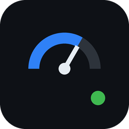
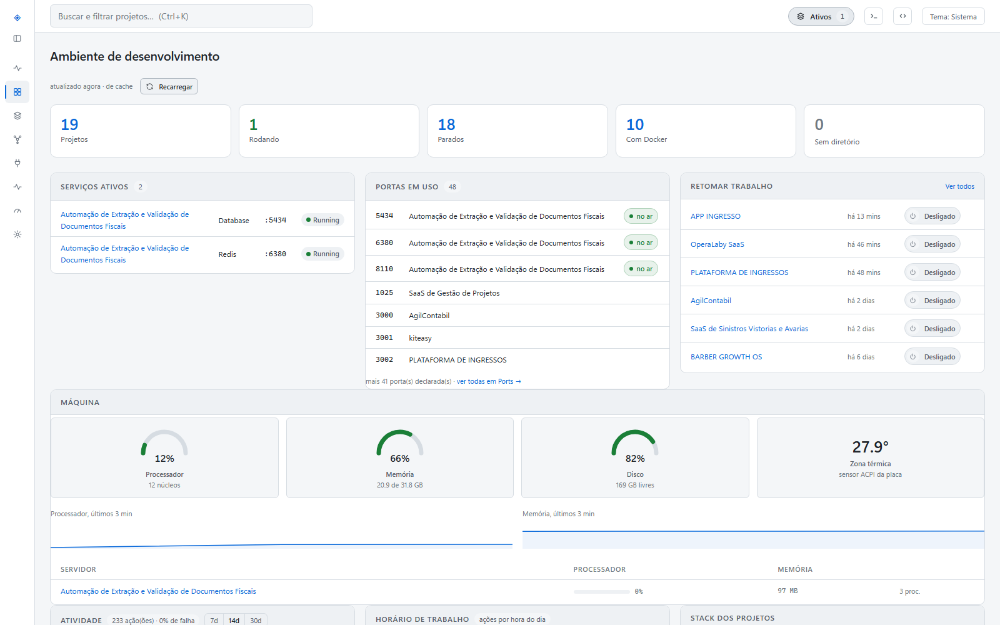
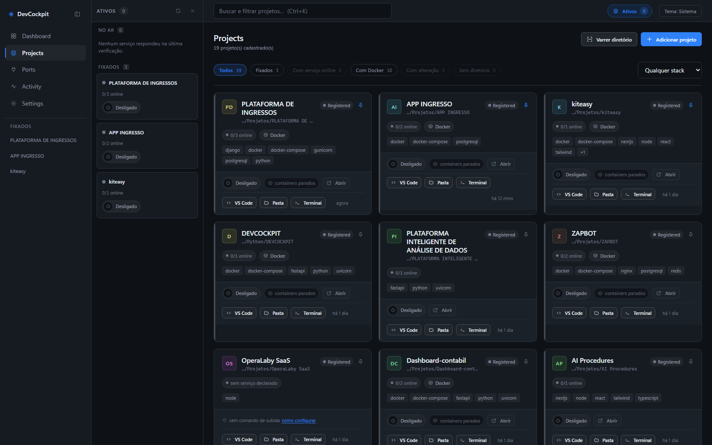
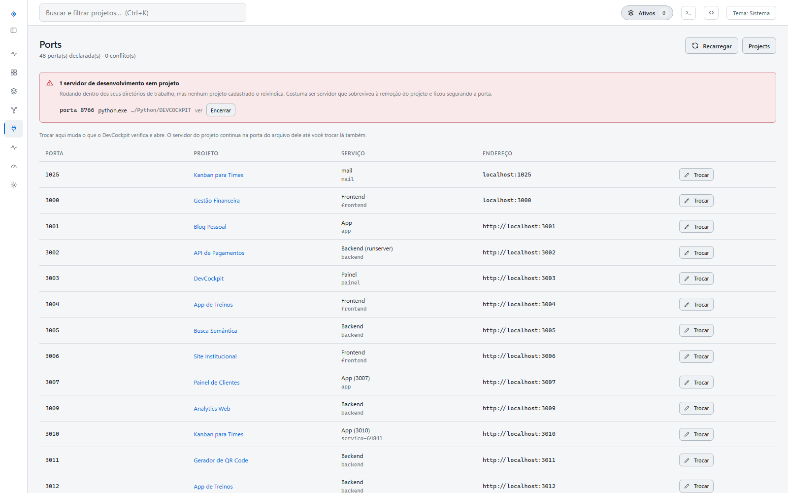
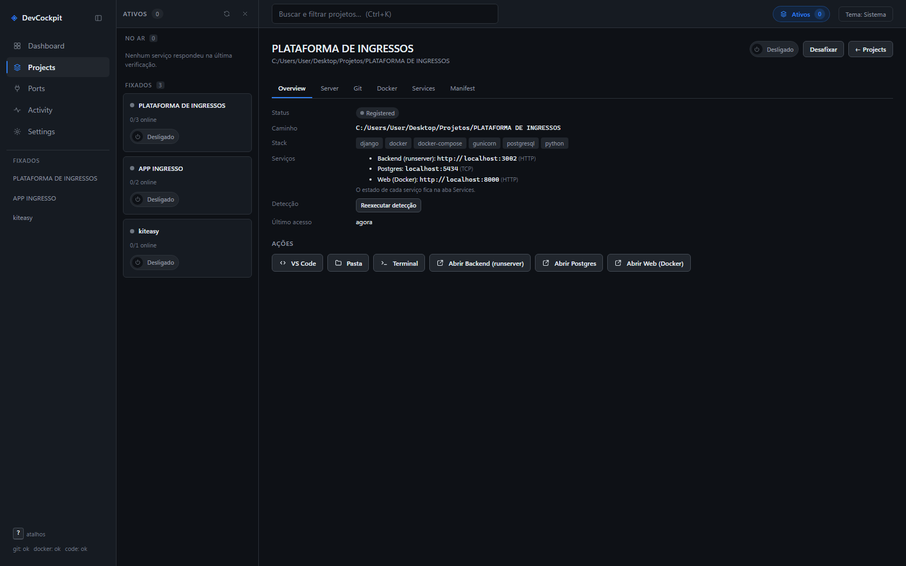
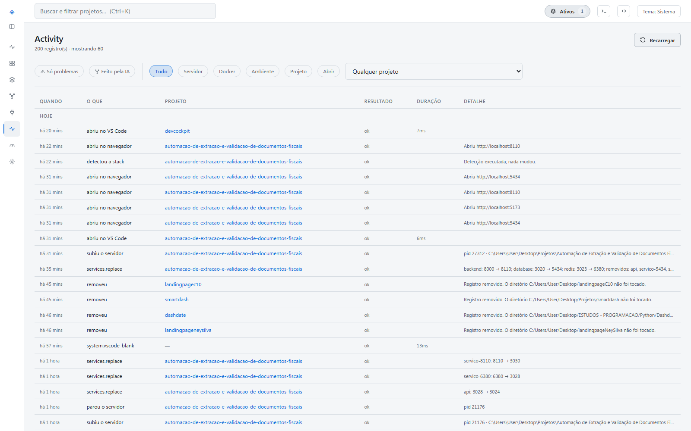
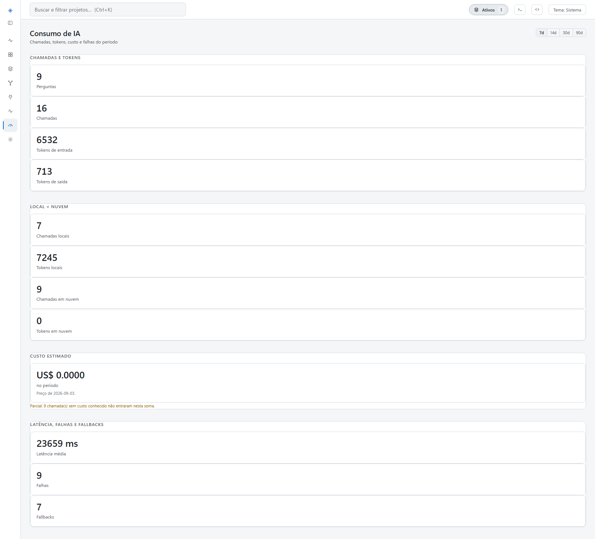
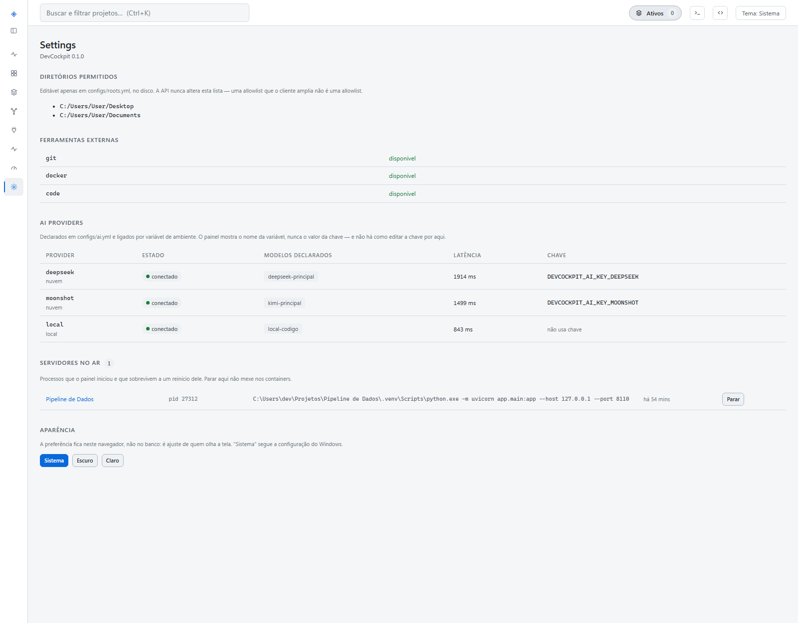
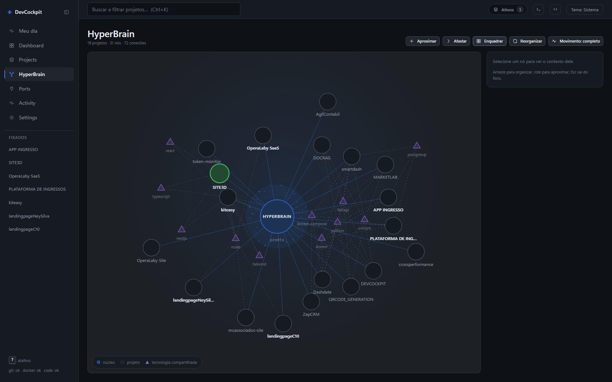

<div align="center">



# DevCockpit

**Central local dos seus projetos de desenvolvimento.**
Um lugar só para saber o que você tem, o que está no ar, o que tem alteração pendente e qual porta é de quem — e operar tudo isso sem abrir terminal.

[](https://www.python.org/)
[](https://fastapi.tiangolo.com/)
[](https://www.sqlite.org/)
[](#testes)
[](#testes)
[](https://docs.astral.sh/ruff/)
[](#plataforma)

<br>



<sub>O dashboard: totais do ambiente, mapa de portas com prova de dono, e o que dá para retomar agora.</sub>

</div>

---

## O problema

Manter 30 projetos locais é manter 30 conjuntos de conhecimento operacional na cabeça: onde a pasta está, qual comando sobe, qual porta usa, qual container é de qual projeto, o que ficou sem commit. Retomar um projeto parado há três semanas custa de 5 a 15 minutos de arqueologia — e a conta se paga várias vezes por dia.

Toda essa informação já está no disco. O DevCockpit lê, guarda o que não é derivável e põe as ações a um clique.

## O que ele faz

| | |
|---|---|
| **Descobre** | varre uma pasta raiz e encontra os projetos: 31 achados em 0,19 s num Desktop real |
| **Identifica** | detecta a stack por marcadores (`pyproject.toml`, `package.json`, `docker-compose.yml`, `vite.config.*`…) e extrai as portas declaradas |
| **Observa** | quem está escutando em cada porta, **com prova de dono** — e conflitos marcados na linha |
| **Opera** | liga e desliga o ambiente: Compose e servidor de desenvolvimento, na ordem certa |
| **Acompanha** | health check dos serviços locais, com histórico e disponibilidade ponderada por tempo |
| **Mostra o Git** | branch, arquivos sujos, commits, remotes — **somente leitura**, sempre |
| **Abre** | VS Code, pasta, terminal e o app no navegador, já no diretório certo |
| **Registra** | auditoria de tudo que foi executado, com desfecho, duração e motivo |
| **Responde** | conversa com contexto do projeto, roteando entre modelo local e nuvem conforme a tarefa — com fallback, custo medido e privacidade como portão |

E responde "e antes?": atividade por dia, horário de trabalho e uso de stack, a partir do que o próprio painel mediu.

## Uma decisão de projeto que atravessa tudo

> **Prova afirma, inferência sugere, ausência se cala.**

Um painel que diz "no ar" quando não sabe é pior que um painel que não diz nada — depois da segunda vez, ninguém acredita na tela.

Exemplo real: dois projetos declarando a porta 8000, um deles parado. O painel dizia que os dois estavam rodando, porque a verificação de saúde abre um socket e pergunta *"tem alguém aí?"*, nunca *"quem?"*. Hoje a atribuição de porta de container vem do rótulo do Compose — que é fato, não dedução —, e o que não tem prova aparece como **"porta ocupada"**, fora da contagem de projetos rodando.

## Segurança

O DevCockpit executa comandos na sua máquina. Isso é o produto — e é o risco. Quatro garantias estruturais, todas verificadas por teste automatizado:

1. **Escuta só em `127.0.0.1`.** Validado no código, não na configuração. Não existe flag para expor na rede.
2. **Nenhum comando vem do cliente.** A interface envia identificadores de ação (`docker.up`); a tradução para argv é tabela fixa no código. Não existe `/execute-command`. Execução sempre sem shell, com argv em lista.
3. **Todo path é validado** contra uma allowlist de diretórios raiz, com resolução de symlink. A allowlist só é editável no disco, nunca pela API.
4. **`Host` e `Origin` validados** — é o que fecha DNS rebinding, o ataque que derrota a checagem ingênua de origem.

O modelo completo, com ameaças, defesas e testes obrigatórios, está em [`docs/07-security-model.md`](docs/07-security-model.md).

## Cockpit AI

O painel conversa com um modelo **sobre o projeto aberto** — contexto montado do README, do manifesto e do estado real (Git, serviços, portas). Três especialistas com chapéu próprio: DevOps, Full Stack e QA.

A regra que sustenta tudo: **a IA não ganha capacidade que o painel não tenha por botão.** `app/services/ai/actions.py` é um catálogo fechado; cada entrada aponta para a rota que o botão correspondente já chama. O modelo escolhe um nome, o servidor valida, a tela mostra, você confirma — e a execução vai pela rota de sempre. Nome fora do catálogo vira recusa, nunca uma ação aproximada.

### O AI Harness

Abaixo do chat, a camada que escolhe *quem* responde:

| | |
|---|---|
| **Registro declarativo** | providers e modelos vivem em `configs/ai.yml`, separados. Trocar o modelo de um fornecedor é editar uma linha — nenhum nome de modelo espalhado pelo código |
| **Classificação por regra** | tipo da tarefa, complexidade, privacidade e necessidade de ferramenta, em **menos de 1 ms** e sem gastar um token. Classificar com modelo custava de 3 a 26 s nesta máquina — mais que a própria resposta |
| **Roteamento determinístico** | privacidade primeiro, escolha manual depois, complexidade por último. A política inteira cabe numa função legível |
| **Fallback real** | provider que falha cede a vez ao próximo; nenhum é tentado duas vezes. Erro de configuração num fornecedor não impede os outros |
| **Custo medido** | uma linha por tentativa, com provider, modelo, tokens, latência e custo — e a data da tabela de preço junto do valor |

**Privacidade é portão, não preferência.** Pergunta classificada como local vai para o modelo da própria máquina, sempre. Sem modelo local disponível, ela é **recusada com explicação** — nunca promovida para a nuvem, nem quando você pede um modelo de nuvem à mão.

**Nada de chave na interface.** O `configs/ai.yml` nomeia a variável de ambiente (`api_key_env`); o valor é lido do ambiente na hora de montar o provider. A carga do arquivo *recusa* qualquer campo com cara de chave. A tela mostra o nome da variável e o estado do provider — jamais o valor, nem mascarado.

O ciclo foi construído por spec, requisito a requisito, em [`docs/specs/ai-harness-mvp/`](docs/specs/ai-harness-mvp/) — com [auditoria](docs/specs/ai-harness-mvp/audit.md) conferindo cada REQ contra o código. As regras vinculantes do projeto estão em [`docs/constitution.md`](docs/constitution.md).

## As telas

<table>
<tr>
<td width="50%">

<sub><b>Projects</b> — cada card mostra serviços no ar, Docker, stack detectada e as ações de abrir; filtros por fixado, online, Docker e alteração pendente.</sub>
</td>
<td width="50%">

<sub><b>Ports</b> — quem declara o quê, o que está mesmo escutando, e o aviso que mais poupa tempo: <i>"o projeto responde, só que em outra porta"</i>, com o conserto a um clique.</sub>
</td>
</tr>
<tr>
<td>

<sub><b>Projeto</b> — Overview, Server, Git, Docker, Services e Manifest. As ações abrem VS Code, pasta, terminal e cada serviço no endereço certo.</sub>
</td>
<td>

<sub><b>Análise</b> — atividade por dia e por hora, stack dos projetos e o estado da máquina. Gráficos em SVG à mão, sem biblioteca.</sub>
</td>
</tr>
<tr>
<td>

<sub><b>AI Usage</b> — chamadas, tokens, divisão local × nuvem, latência e fallbacks. O custo vem com a data da tabela de preço, e o aviso <i>"parcial: N chamadas sem custo conhecido"</i> aparece em vez de apresentar um total incompleto como se fosse fechado.</sub>
</td>
<td>

<sub><b>Settings</b> — diretórios permitidos, ferramentas externas e os providers de IA com o estado de cada um. A coluna da chave mostra o <b>nome da variável de ambiente</b>, nunca o valor.</sub>
</td>
</tr>
<tr>
<td colspan="2">

<sub><b>HyperBrain</b> — o ecossistema como mapa: o núcleo, os projetos e as tecnologias que ligam projeto a projeto. Foco atenua o resto, arrastar organiza, e o nó fica onde foi solto. Também em SVG à mão, sem biblioteca de grafo (<a href="docs/adr/ADR-009-graph-rendering.md">ADR-009</a>).</sub>
</td>
</tr>
</table>

## Instalação

### Como aplicativo (sem Python instalado)

```powershell
powershell -ExecutionPolicy Bypass -File scripts\build_exe.ps1 -Install
```

Gera `dist\DevCockpit` (~59 MB) e instala uma cópia em `%USERPROFILE%\DevCockpit`. A instalação troca só o programa: `data\`, `logs\` e `configs\` são preservados.

Abre em **janela própria** (WebView2, o motor do Edge que já vem no Windows 11): sem barra de endereço, sem abas, com ícone na barra de tarefas. Fechar a janela encerra o servidor. Sem WebView2, cai para o navegador em vez de falhar.

Na primeira execução ele cria `data\`, `logs\` e `configs\` ao lado do executável, aplica as migrações e escolhe a porta (8765, ou a próxima livre). Abre em ~1,5 s.

<details>
<summary>Atalho no Desktop com porta fixa</summary>

```powershell
$s = (New-Object -ComObject WScript.Shell).CreateShortcut("$env:USERPROFILE\Desktop\DevCockpit.lnk")
$s.TargetPath = "$env:USERPROFILE\DevCockpit\DevCockpit.exe"
$s.Arguments = '--port 8790'
$s.WorkingDirectory = "$env:USERPROFILE\DevCockpit"
$s.Save()
```

Opções: `--port 9000` fixa a porta, `--no-window` usa o navegador, `--no-browser` só sobe o servidor.
</details>

### Como repositório (desenvolvimento)

```powershell
powershell -ExecutionPolicy Bypass -File scripts\dev.ps1      # cria venv, migra e sobe
powershell -ExecutionPolicy Bypass -File scripts\serve.ps1    # modo solto, sobrevive ao terminal
```

**Passo obrigatório antes do primeiro cadastro** — defina os diretórios permitidos:

```powershell
copy configs\roots.example.yml configs\roots.yml
```

Sem isso nenhum projeto pode ser cadastrado, por decisão de segurança (defesa D4).

## Primeiros passos

1. **Projects → Varrer diretório** — aponte sua pasta de projetos e importe em lote.
2. **Fixe os 3 ou 4 do momento** — eles vão para a barra lateral e são os únicos que o verificador acompanha em background.
3. **Dashboard** passa a responder: o que está no ar, o que tem alteração pendente, qual porta está em conflito.

Atalhos: `Ctrl+K` busca projeto, `Ctrl+B` recolhe a lateral, `g d` vai ao Dashboard, `g p` a Projects, `r` recarrega.

## Arquitetura

```
rota HTTP  →  serviço  →  repositório  →  SQLite
                 ↓
             adapter  →  CommandRunner  →  processo externo
```

```
app/
  api/routes/        rotas HTTP — não conhecem o sistema operacional
  core/              config, log, erros, validação de path, cache
  models/ schemas/   SQLAlchemy e Pydantic
  repositories/      acesso a dados, sem query espalhada
  services/          casos de uso
  runner/            CommandRunner — único ponto de execução
  jobs/              execução assíncrona com console via SSE
  detection/         registry extensível de detectores de stack
  adapters/          git · docker · system
  services/ai/       registro de providers · classificador · router · runner
  launcher.py        ponto de entrada do aplicativo empacotado
frontend/            HTML, CSS e ES modules — sem build, sem dependência
migrations/ configs/ docs/ tests/ scripts/
```

| Camada | Tecnologia |
|--------|-----------|
| Backend | Python 3.11+, FastAPI, Pydantic v2, SQLAlchemy, Alembic |
| Banco | SQLite (WAL) |
| Frontend | HTML, CSS e JavaScript — ES modules, **sem framework e sem build** |
| Empacotamento | PyInstaller + pywebview (WebView2) |
| Externo | `git` CLI, `docker compose` v2 CLI |

Cada escolha tem ADR em [`docs/adr/`](docs/adr/).

## Testes

```powershell
.venv\Scripts\python.exe -m pytest -q                              # tudo
.venv\Scripts\python.exe -m pytest -q --cov=app --cov-report=term  # com cobertura
.venv\Scripts\python.exe -m ruff check app tests
```

**969 testes**, cobertura **90%**, mais 89 no frontend. A suíte de frontend roda no runner do próprio Node (`node --test`), sem `node_modules`, e é chamada de dentro do `pytest` — comando único. Testes que exigem Docker estão marcados e não rodam por padrão.

Há testes que existem para proteger decisões, não código: um varre o fonte e reprova se `subprocess` for importado fora de `app/runner/`; outro garante que nenhum verbo destrutivo do Docker é alcançável por qualquer caminho da API.

Na camada de IA, três guardam garantias que só quebrariam em produção: um planta uma chave no ambiente e **varre as respostas das rotas e o HTML servido** atrás dela — inclusive fatias de 8 a 12 caracteres, que é o que um mascaramento parcial deixaria escapar; outro prova que pergunta marcada como privada **falha o teste se a escolha cair em provider de nuvem**; e um terceiro reproduz de propósito o bug de transação aberta durante o stream, para provar que o conserto ainda segura.

## Documentação

| Doc | Conteúdo |
|-----|----------|
| [00 — Visão de produto](docs/00-product-vision.md) | problema, público, valor |
| [02 — Requisitos funcionais](docs/02-functional-requirements.md) | `FR-001` em diante |
| [04 — Arquitetura](docs/04-system-architecture.md) | camadas, fluxos, estrutura |
| [05 — Modelo de dados](docs/05-data-model.md) | entidades, campos, índices |
| [06 — API](docs/06-api-specification.md) | endpoints, payloads, erros |
| [07 — Segurança](docs/07-security-model.md) | ameaças, defesas, testes obrigatórios |
| [12 — Decisões](docs/12-decisions.md) | índice de ADRs e decisões menores |
| [constitution.md](docs/constitution.md) | as 7 regras vinculantes do projeto — violação é bloqueio, não sugestão |
| [ai/](docs/ai/) | arquitetura do **Cockpit AI** — orquestrador, especialistas, contexto e memória |
| [specs/ai-harness-mvp/](docs/specs/ai-harness-mvp/) | o **AI Harness** requisito a requisito, com plano, tasks e auditoria |
| [logs/session-log.md](logs/session-log.md) | índice do diário técnico; uma sessão por arquivo em [`logs/sessions/`](logs/sessions/) |

## Roadmap

- [x] Descoberta, detecção de stack e cadastro em lote
- [x] Git somente leitura, Docker Compose, health de serviços locais
- [x] Mapa de portas com prova de dono e resolução de conflito
- [x] Ligar/desligar ambiente, com Compose e servidor de dev
- [x] Análise histórica (atividade, disponibilidade, stack)
- [x] Aplicativo empacotado com janela nativa
- [x] **Cockpit AI** — contexto de projeto, três especialistas e catálogo fechado de ações
- [x] **AI Harness** — registro de providers, roteamento, fallback e custo medido
- [x] **HyperBrain** — o ecossistema como grafo, e o Ask ligado ao contexto
- [x] **HyperBrain MVP 3** — tarefas, sessões, decisões e serviços no contexto do nó
- [ ] HyperBrain: documentação do projeto como fonte, e atividade ao vivo no mapa
- [ ] Integração com GitHub (PRs, issues, Actions)

## Plataforma

Windows 11, por decisão ([ADR-007](docs/adr/ADR-007-os-abstraction-windows-first.md)): as ações de sistema operacional passam por um adapter, e portar para Linux/macOS é implementar esse adapter — o resto do código não conhece o sistema.

## O que ele não faz — por decisão

```
terminal web · editor de código · IDE embutida · CI/CD próprio
Kubernetes · execução remota · multiusuário · escrita destrutiva no Git
```

E na camada de IA:

```
agente autônomo sem confirmação · IA escrevendo arquivo em projeto seu
terminal exposto ao modelo · chave de API editável pela tela
```

Não são "features futuras": exigiriam refazer o modelo de segurança inteiro.

---

<div align="center">
<sub>Projeto pessoal, desenvolvido com apoio de IA e documentado decisão a decisão.</sub>
</div>
