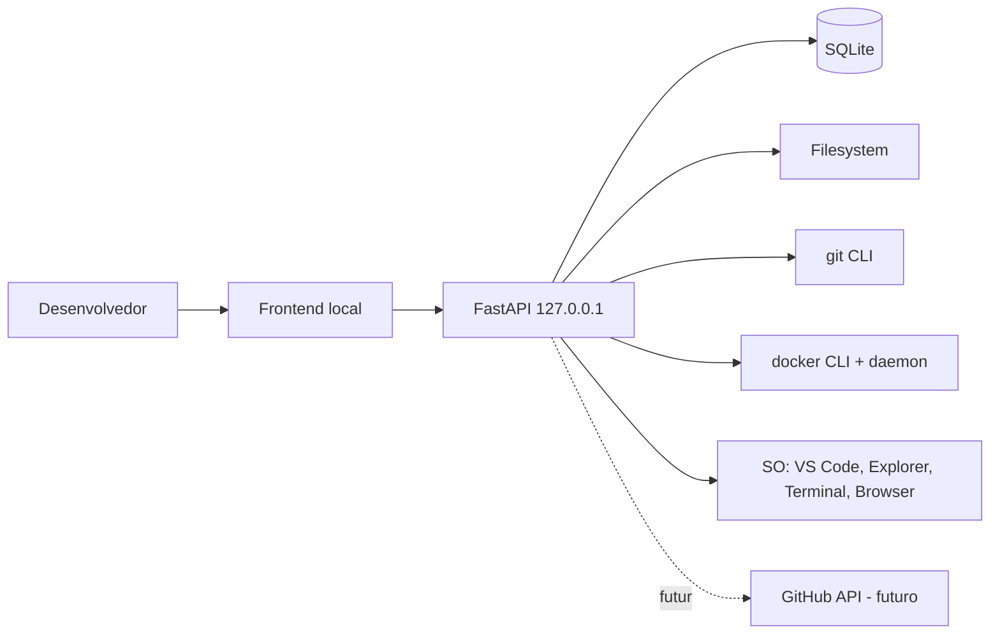
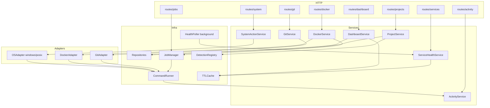
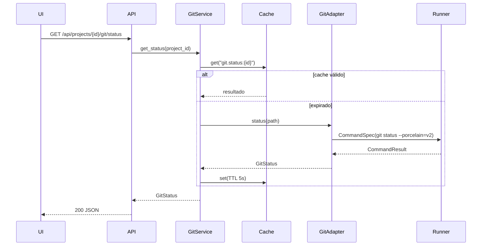
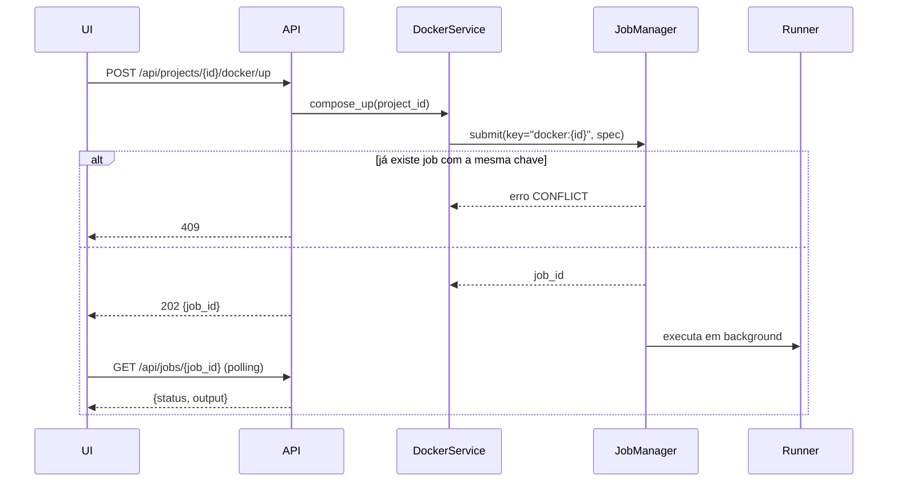
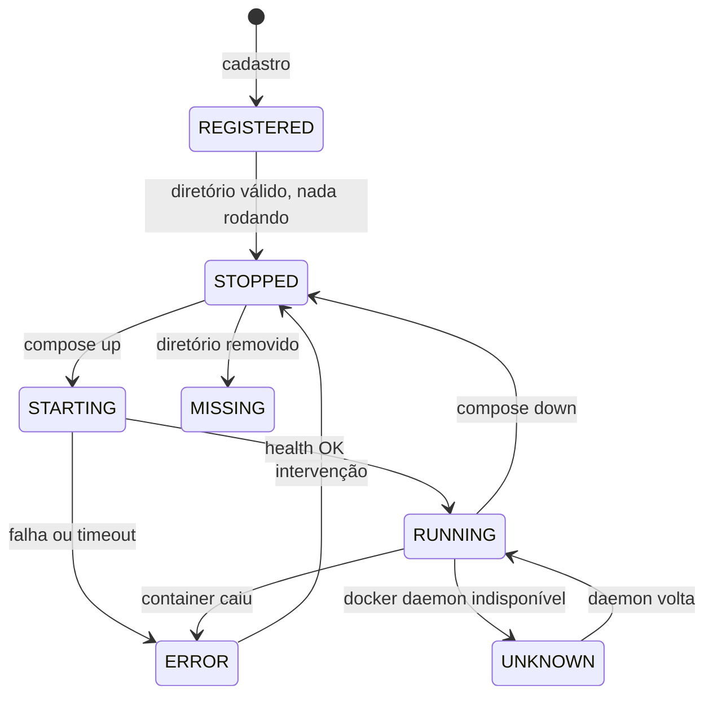

# 04 — Arquitetura do Sistema

## Princípio estruturante

Uma única regra organiza o sistema:

> **A camada HTTP nunca conhece o sistema operacional. O sistema operacional
> nunca é alcançado sem passar pelo CommandRunner.**

Toda a segurança do DevCockpit deriva disso. Se um endpoint conseguir montar um
comando, o modelo de allowlist já foi furado.

## Camadas

```
┌──────────────────────────────────────────────┐
│ Frontend (HTML/CSS/JS, sem build)            │
└───────────────────┬──────────────────────────┘
                    │ fetch / SSE (JSON)
┌───────────────────▼──────────────────────────┐
│ API — FastAPI routers                        │  valida entrada, traduz erro
│ (não conhece subprocess nem path de SO)      │  em HTTP status
└───────────────────┬──────────────────────────┘
┌───────────────────▼──────────────────────────┐
│ Application Services                         │  orquestra caso de uso,
│ Project / Git / Docker / Service / System    │  decide síncrono vs job
└──────┬──────────────────┬────────────┬───────┘
       │                  │            │
┌──────▼──────┐   ┌───────▼──────┐  ┌──▼──────────┐
│ Repositories│   │ JobManager   │  │ Detection   │
│ (SQLAlchemy)│   │ (async)      │  │ Registry    │
└──────┬──────┘   └───────┬──────┘  └──┬──────────┘
       │                  │            │
       │          ┌───────▼────────────▼───────┐
       │          │ CommandRunner              │  argv, timeout, captura,
       │          │ (único ponto de execução)  │  auditoria
       │          └───────────┬────────────────┘
       │          ┌───────────▼────────────────┐
       │          │ Adapters                   │  montam argv, parseiam saída
       │          │ Git / Docker / OS / GitHub │
       │          └───────────┬────────────────┘
┌──────▼──────┐   ┌───────────▼────────────────┐
│  SQLite     │   │ git · docker · code · shell │
└─────────────┘   └────────────────────────────┘
```

## Diagrama de contexto



## Diagrama de componentes



## Responsabilidade de cada camada

### API (`app/api/routes/`)
Valida payload com Pydantic, chama um service, traduz exceção de domínio em
status HTTP. Não importa `subprocess`, `pathlib` para montar comando, nem
adapter diretamente.

### Application Services (`app/services/`)
Onde vive o caso de uso. Decide se a operação é síncrona (leitura rápida,
cacheável) ou vira job (operação longa). Combina repositório + adapter +
cache. Não formata resposta HTTP.

Serviços do MVP:

| Serviço | Responsabilidade |
|---------|------------------|
| `ProjectService` | CRUD, validação de path, descoberta, re-detecção |
| `GitService` | estado do repositório (somente leitura) |
| `DockerService` | estado dos containers e operações Compose via job |
| `ServiceHealthService` | health check de serviços locais + cache |
| `SystemActionService` | VS Code, pasta, terminal, browser |
| `DashboardService` | agregação para a home |
| `ActivityService` | escrita e leitura do log de auditoria |

`SystemService` e `ProcessService` do prompt original foram fundidos em
`SystemActionService`; a parte de inspeção de porta/processo entra no
`ServiceHealthService`, que é quem tem contexto para usá-la.

### CommandRunner (`app/runner/`)
Ponto único de execução. Recebe uma **especificação de comando** já validada:

```
CommandSpec(
    argv:        list[str]      # nunca string
    cwd:         Path           # já validado contra allowlist
    timeout_s:   float          # obrigatório
    env_extra:   dict[str,str]  # opcional, sem segredo
    label:       str            # p.ex. "git.status", para auditoria
)
```

Devolve `CommandResult(exit_code, stdout, stderr, duration_ms, timed_out)`.
Responsabilidades: executar sem shell, aplicar timeout e matar o processo,
capturar as saídas, medir duração e registrar auditoria.

O `CommandRunner` **não decide o que pode rodar**. Quem decide é a allowlist
consultada antes dele — ver `07-security-model.md`.

### Adapters (`app/adapters/`)
Traduzem intenção em argv e saída bruta em objeto de domínio. Um adapter só
sabe montar comando e parsear texto; não conhece banco nem HTTP.

- `GitAdapter` — usa o `git` CLI com formato estável (`--porcelain=v2`,
  `--format=%H%x1f%an...`), não parseia saída humana.
- `DockerAdapter` — usa `docker compose ps --format json` e
  `docker compose <ação>`. Compose v2 via CLI, não SDK (ver `ADR-003`).
- `OSAdapter` — interface com implementação por plataforma. É aqui que mora
  toda a diferença entre `wt.exe` e `gnome-terminal`.

### Detection (`app/detection/`)
Registry de detectores. Cada detector responde: "este diretório contém a marca
X?" e devolve tecnologias, arquivos relevantes e portas prováveis. Adicionar
suporte a uma stack nova é adicionar um arquivo e registrá-lo. Nenhum `if`
gigante.

### JobManager (`app/jobs/`)
Fila em memória de tarefas assíncronas com estado, saída acumulada e timeout.
Impõe exclusão mútua por chave (`project_id + tipo de operação`), atendendo
FR-057. Estado dos jobs é volátil por design: reiniciar o app perde o
histórico *em execução*, mas o resultado final vai para o log de auditoria,
que é persistente.

## Fluxos principais

### Leitura de estado (síncrono, cacheado)



### Operação longa (assíncrona)



## Estados de projeto



`UNKNOWN` e `MISSING` existem para satisfazer NFR-060 e NFR-062: o sistema
sempre tem um estado honesto para exibir, e nunca precisa mentir nem quebrar.

## Estrutura de diretórios adotada

Revisão da proposta original do prompt. Mudanças e motivo:

| Mudança | Motivo |
|---------|--------|
| `integrations/` renomeado para `adapters/` | é padrão hexagonal e o nome descreve o papel |
| `+ app/runner/` | o CommandRunner é camada própria, não um service |
| `+ app/jobs/` | execução assíncrona é infraestrutura, não caso de uso |
| `+ app/detection/` | registry extensível, fora de `services/` |
| `+ app/core/errors.py` | hierarquia de exceção de domínio, para o mapeamento HTTP |
| `+ app/core/paths.py` | validação de path em um só lugar (NFR-004) |
| `+ migrations/` | schema versionado desde o dia um (NFR-072) |
| `frontend/js/pages/` e `js/lib/` | separação por página, sem framework |
| `configs/` mantido | roots permitidos e defaults, fora do banco |

```
devcockpit/
├── app/
│   ├── main.py                  # cria o app, monta rotas, valida bind local
│   ├── api/
│   │   ├── routes/
│   │   │   ├── projects.py  git.py  docker.py  services.py
│   │   │   ├── system.py    jobs.py dashboard.py activity.py
│   │   └── deps/                # injeção: sessão, services, guard CSRF
│   ├── core/
│   │   ├── config.py            # Settings (pydantic-settings)
│   │   ├── logging.py           # log estruturado
│   │   ├── errors.py            # DomainError e derivadas
│   │   ├── paths.py             # canonicalização + allowlist de roots
│   │   └── cache.py             # TTLCache
│   ├── models/                  # SQLAlchemy
│   ├── schemas/                 # Pydantic (request/response)
│   ├── repositories/            # acesso a dados, sem query espalhada
│   ├── services/                # casos de uso
│   ├── runner/
│   │   ├── command_runner.py
│   │   ├── command_spec.py
│   │   └── allowlist.py         # comandos base permitidos
│   ├── jobs/
│   │   ├── job_manager.py
│   │   └── job.py
│   ├── detection/
│   │   ├── registry.py
│   │   └── detectors/           # um arquivo por stack
│   └── adapters/
│       ├── git/  docker/  system/  github/
├── frontend/
│   ├── index.html
│   ├── css/{tokens,base,components,layout}.css
│   ├── js/
│   │   ├── main.js  router.js
│   │   ├── lib/{api,store,dom,format}.js
│   │   └── pages/{dashboard,projects,project,git,docker,services,activity,settings}.js
│   └── assets/
├── migrations/
├── data/                        # SQLite (fora do versionamento)
├── configs/                     # roots permitidos, defaults
├── docs/  + docs/adr/
├── tests/{unit,integration,fixtures}/
├── scripts/
├── docker/
├── .env.example  .gitignore  README.md  pyproject.toml  PROJECT_STATUS.md
```

`docker-compose.yml` na raiz fica para a Fase 5: no MVP, containerizar o
DevCockpit é contraprodutivo, porque ele precisa falar com o Docker e com o
filesystem do host.
