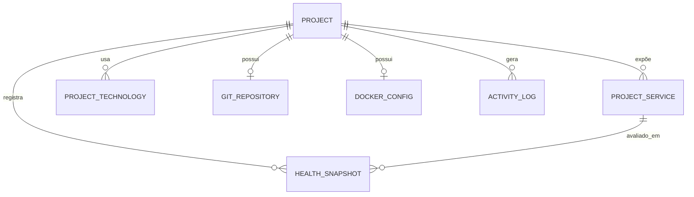

# 05 — Modelo de Dados

Banco: SQLite no MVP, com abstração via SQLAlchemy e migrações versionadas
para permitir troca por PostgreSQL sem reescrita (ver `ADR-002`).

## Entidades

## PROJECT

| Campo | Tipo | Regra |
|-------|------|-------|
| `id` | TEXT PK | slug derivado do nome, único |
| `name` | TEXT NOT NULL | rótulo exibido |
| `description` | TEXT NULL | |
| `path` | TEXT NOT NULL UNIQUE | absoluto e canonicalizado |
| `status` | TEXT NOT NULL | `REGISTERED`, `STOPPED`, `STARTING`, `RUNNING`, `ERROR`, `UNKNOWN`, `MISSING` |
| `is_pinned` | BOOLEAN default 0 | FR-008 |
| `detection_locked` | BOOLEAN default 0 | quando 1, novo scan não sobrescreve stack (FR-024) |
| `last_accessed_at` | DATETIME NULL | FR-007 |
| `created_at` | DATETIME NOT NULL | |
| `updated_at` | DATETIME NOT NULL | |

`path` é a chave natural do domínio: dois registros para o mesmo diretório são
sempre erro. `id` é slug para dar URL legível.

`status` é **estado observado**, derivado e atualizado pelo poller. Não é
entrada do usuário. É persistido apenas para o dashboard poder responder de
cache (NFR-010).

## PROJECT_TECHNOLOGY

| Campo | Tipo | Regra |
|-------|------|-------|
| `id` | INTEGER PK | |
| `project_id` | TEXT FK | cascade delete |
| `name` | TEXT NOT NULL | `python`, `fastapi`, `node`, `docker`, ... |
| `category` | TEXT NOT NULL | `language`, `framework`, `runtime`, `database`, `tooling` |
| `source` | TEXT NOT NULL | `DETECTED` ou `MANUAL` |
| `evidence` | TEXT NULL | arquivo que originou a detecção |

Única em (`project_id`, `name`). `source` é o que permite FR-024: um novo scan
substitui apenas linhas `DETECTED`.

## PROJECT_SERVICE

| Campo | Tipo | Regra |
|-------|------|-------|
| `id` | INTEGER PK | |
| `project_id` | TEXT FK | cascade delete |
| `key` | TEXT NOT NULL | `frontend`, `backend`, `api_docs`, `database` |
| `label` | TEXT NOT NULL | nome exibido |
| `host` | TEXT default `localhost` | |
| `port` | INTEGER NULL | |
| `url` | TEXT NULL | URL a abrir no browser |
| `health_url` | TEXT NULL | quando ausente, o check é TCP na porta |
| `health_kind` | TEXT NOT NULL | `HTTP`, `TCP` ou `NONE` |
| `open_in_browser` | BOOLEAN default 1 | |

Único em (`project_id`, `key`).

Decisão: quando `health_url` é nulo mas há porta, o check é **TCP connect** —
mais rápido e não polui log de acesso da aplicação alvo.

## GIT_REPOSITORY

Cache do estado do repositório. Não é fonte de verdade: o disco é.

| Campo | Tipo | Regra |
|-------|------|-------|
| `project_id` | TEXT PK FK | 1:1 |
| `is_repo` | BOOLEAN NOT NULL | |
| `current_branch` | TEXT NULL | nulo se detached |
| `head_sha` | TEXT NULL | |
| `remote_origin_url` | TEXT NULL | |
| `provider` | TEXT NULL | `github`, `gitlab`, `other` — inferido da URL |
| `dirty_count` | INTEGER default 0 | total de arquivos alterados |
| `ahead` | INTEGER NULL | |
| `behind` | INTEGER NULL | |
| `last_commit_subject` | TEXT NULL | |
| `last_commit_at` | DATETIME NULL | |
| `checked_at` | DATETIME NOT NULL | idade do cache |

Só campos agregados. Lista de arquivos e histórico de commits **não** são
persistidos: são consultados ao vivo com TTL curto. Persistir isso criaria a
obrigação de invalidar, sem ganho.

## DOCKER_CONFIG

| Campo | Tipo | Regra |
|-------|------|-------|
| `project_id` | TEXT PK FK | 1:1 |
| `enabled` | BOOLEAN default 0 | |
| `compose_file` | TEXT NULL | relativo ao path do projeto |
| `project_name` | TEXT NULL | `-p` do Compose; default é o nome da pasta |
| `has_dockerfile` | BOOLEAN default 0 | |
| `detected_services` | TEXT NULL | JSON com os serviços lidos do Compose |

`compose_file` é **relativo**, nunca absoluto: torna o registro portável e
força a resolução via `paths.py` (NFR-004).

## HEALTH_SNAPSHOT

| Campo | Tipo | Regra |
|-------|------|-------|
| `id` | INTEGER PK | |
| `project_id` | TEXT FK | |
| `service_id` | INTEGER FK NULL | |
| `state` | TEXT NOT NULL | `ONLINE`, `OFFLINE`, `STARTING`, `ERROR`, `STALE`, `UNKNOWN` |
| `latency_ms` | INTEGER NULL | |
| `detail` | TEXT NULL | mensagem curta de erro |
| `checked_at` | DATETIME NOT NULL | |

Retenção: só o último snapshot por serviço é obrigatório. Histórico é opcional
e limitado por política de purga (padrão 7 dias) para o SQLite não crescer sem
limite.

## ACTIVITY_LOG

| Campo | Tipo | Regra |
|-------|------|-------|
| `id` | INTEGER PK | |
| `project_id` | TEXT FK NULL | nulo em ação global |
| `action` | TEXT NOT NULL | `docker.up`, `git.status`, `system.vscode`, ... |
| `status` | TEXT NOT NULL | `SUCCESS`, `FAILED`, `TIMEOUT`, `DENIED` |
| `duration_ms` | INTEGER NULL | |
| `exit_code` | INTEGER NULL | |
| `argv` | TEXT NULL | JSON do argv executado (FR-101) |
| `message` | TEXT NULL | resumo legível |
| `correlation_id` | TEXT NULL | liga ao log em arquivo (NFR-052) |
| `created_at` | DATETIME NOT NULL | |

`DENIED` é registrado quando a allowlist recusa uma ação. É o sinal mais
importante do sistema: significa tentativa de ação não prevista.

`argv` nunca inclui variável de ambiente (NFR-103).

## Índices

| Tabela | Índice | Motivo |
|--------|--------|--------|
| PROJECT | `path` UNIQUE | integridade |
| PROJECT | `status` | filtro do dashboard |
| PROJECT | `last_accessed_at DESC` | projetos recentes |
| PROJECT_SERVICE | (`project_id`, `key`) UNIQUE | integridade |
| PROJECT_SERVICE | `port` | detecção de conflito (FR-064) |
| ACTIVITY_LOG | (`project_id`, `created_at DESC`) | histórico por projeto |
| HEALTH_SNAPSHOT | (`service_id`, `checked_at DESC`) | último estado |

## O que deliberadamente não é persistido

| Dado | Por quê |
|------|---------|
| lista de arquivos alterados | volátil, TTL curto resolve |
| histórico de commits | o Git já é o banco disso |
| logs de container | o Docker já retém; duplicar é desperdício |
| estado de job em execução | volátil por design; o resultado vai para `ACTIVITY_LOG` |
| conteúdo de arquivo do projeto | fora de escopo; não somos editor |
